# BuildSphere
## Enterprise Construction Intelligence & Project Delivery Platform

**One connected workspace for construction portfolios, project controls, field delivery, commercial performance, quality, safety and controlled information.**

BuildSphere is a multi-tenant construction technology platform built around a practical delivery lifecycle: plan the work, control cost and commitments, coordinate the field, assure quality and safety, govern project information, and turn operational evidence into actionable decisions.

> **Project status:** Active engineering project. The repository contains a working React/Express/MongoDB foundation and implemented workflow modules. It is not a certified construction-management system and should not be represented as production-ready without deployment-specific security, storage, legal, financial and operational validation.

---

## 1. Product at a glance

- **Portfolio command centre:** project overview, delivery status, budgets and portfolio-level visibility.
- **Project controls:** project records, work breakdown structure, tasks, milestones, dependencies and assignment.
- **Commercial management:** cost codes, allocated budgets, purchase orders, invoices, payment claims and commercial summaries.
- **Procurement visibility:** commercial commitments and supply-chain signals captured through project records.
- **Field operations:** contractor records, daily site reports, labour and equipment entries, progress, delays and site evidence references.
- **Quality management:** inspections, checklist results, non-conformance reports (NCRs) and corrective/preventive actions (CAPA).
- **Health, safety and environment:** hazards, near misses, incident records, status workflows and immediate actions.
- **Project coordination:** RFIs, submittals, review outcomes and document approvals.
- **Controlled document register:** version history, approval history, private binary uploads, malware scanning, integrity checks and authenticated downloads.
- **Project intelligence:** explainable schedule, commercial, quality, safety and coordination risk signals with linked source evidence.
- **Collaboration:** project membership, task assignment, notification inbox, activity feed and a transaction-backed event outbox.
- **Organization governance:** owner/admin membership controls and safeguards against removing the last active owner.

## 2. Illustrative product screens

The following **12 dashboard images are illustrative UI concepts** created for product communication. They use synthetic names, values and status indicators; they are not screenshots of live production data or proof that every depicted chart/widget is currently implemented. Each screen is presented in a single-column sequence.

### 01 — Portfolio overview
Executive view across projects, portfolio value, cost performance and delivery health.

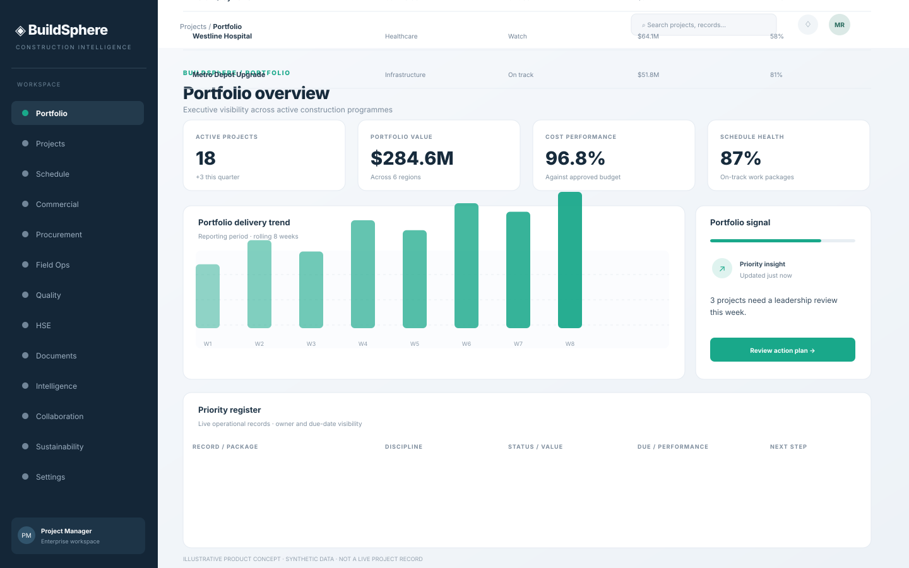

### 02 — Project command centre
A project-level briefing view combining contract value, cost-to-date, physical progress and forecast completion.

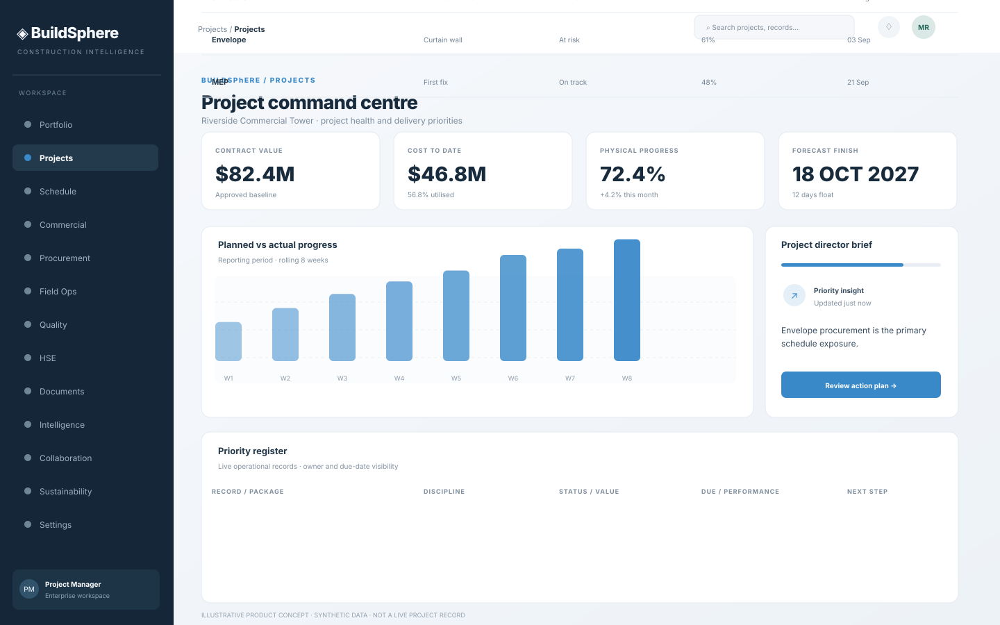

### 03 — Schedule and lookahead
A planning concept for near-term work, milestone exposure, critical float and constraint removal.

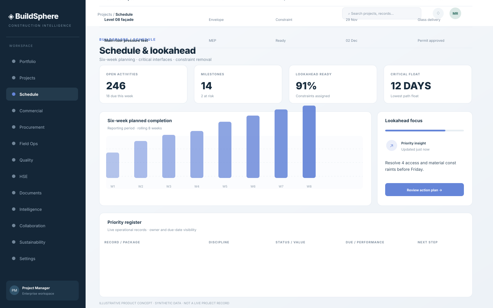

### 04 — Commercial controls
A commercial performance concept for budgets, commitments, paid-to-date values and forecast variance.

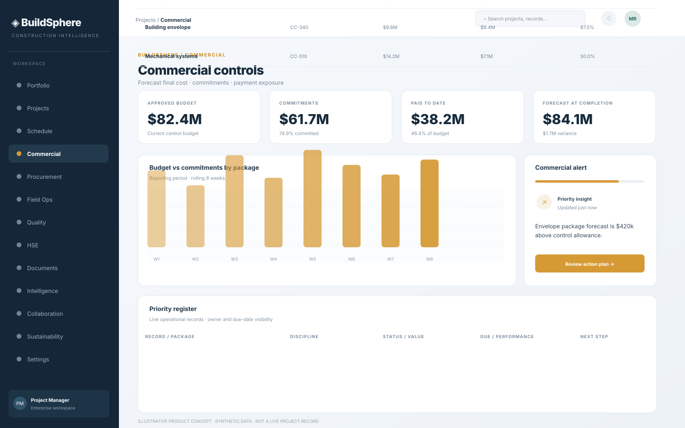

### 05 — Procurement and supply chain
A procurement concept showing package readiness, long-lead materials, supplier commitments and delivery confidence.

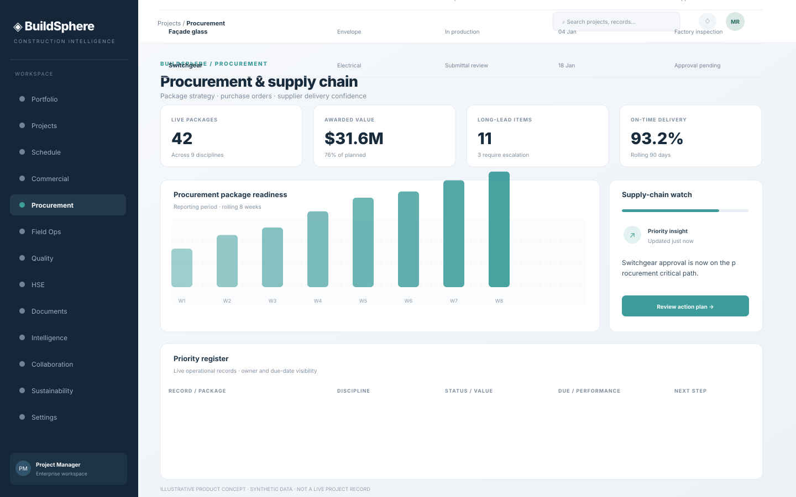

### 06 — Field operations
A site operations concept for workforce, daily reports, equipment utilisation, installed quantities and field queries.

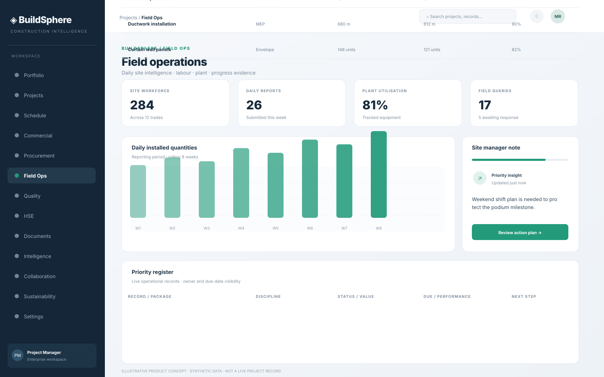

### 07 — Quality assurance
A quality-control concept for inspections, first-pass performance, open NCRs and overdue corrective actions.

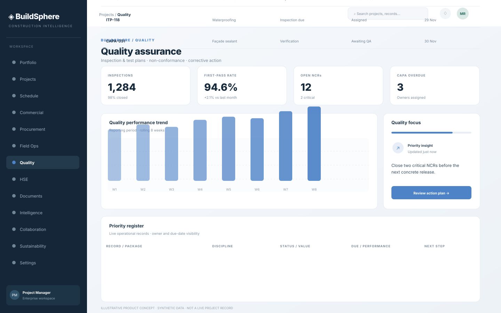

### 08 — Health, safety and environment
A safety and environmental concept for safe-work hours, observations, high-risk controls and compliance indicators.

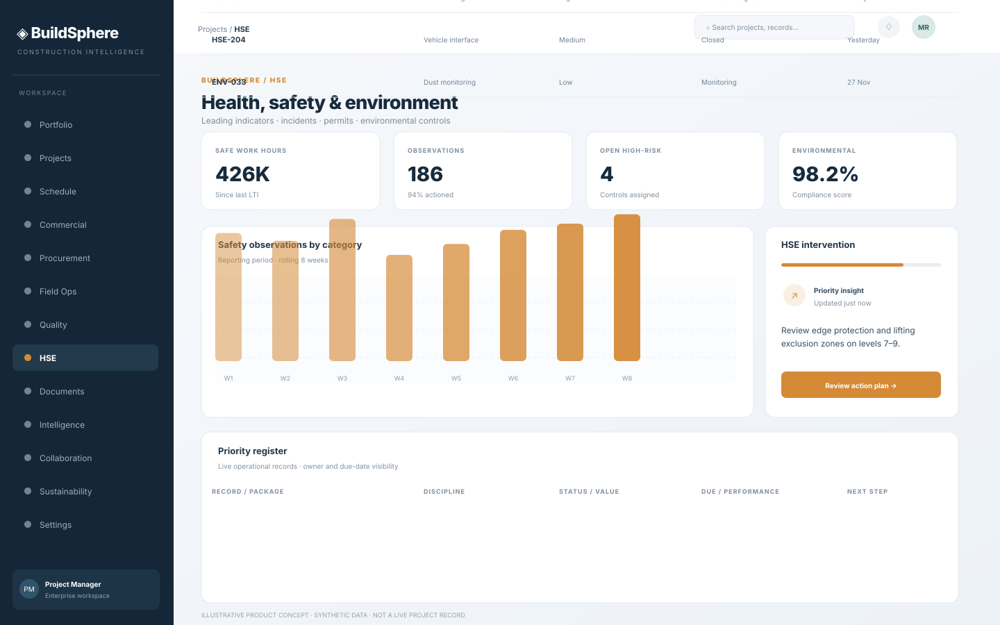

### 09 — Document control / common data environment
A controlled-information concept for revisions, approval queues, secure files and traceable project records.

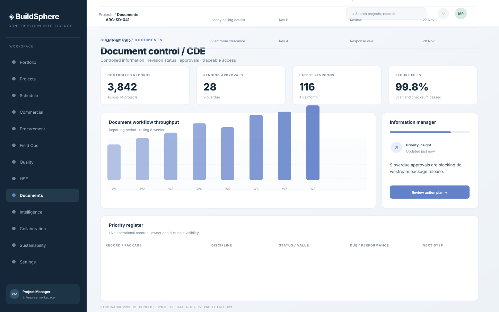

### 10 — AI project intelligence
An explainable decision-support concept for evidence-backed schedule, commercial and quality risk signals.

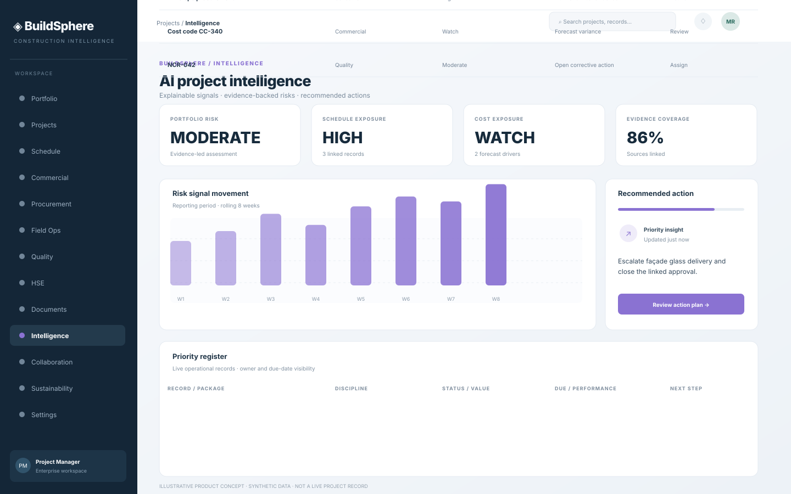

### 11 — Team collaboration
A collaboration concept for project membership, notifications, assignments and decision follow-through.

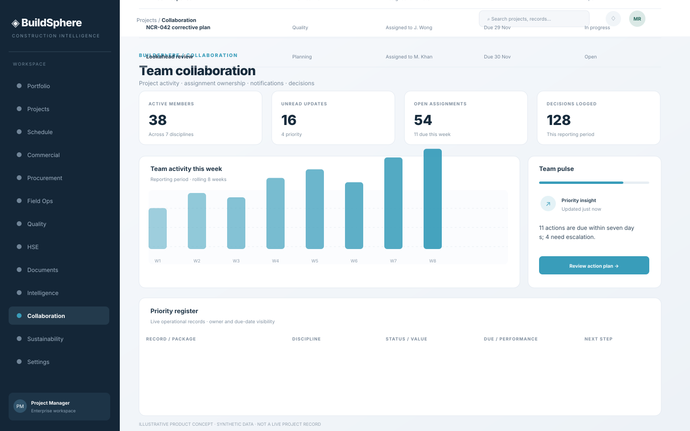

### 12 — ESG and carbon performance
A sustainability concept for embodied carbon, material impacts, waste diversion and responsible procurement.

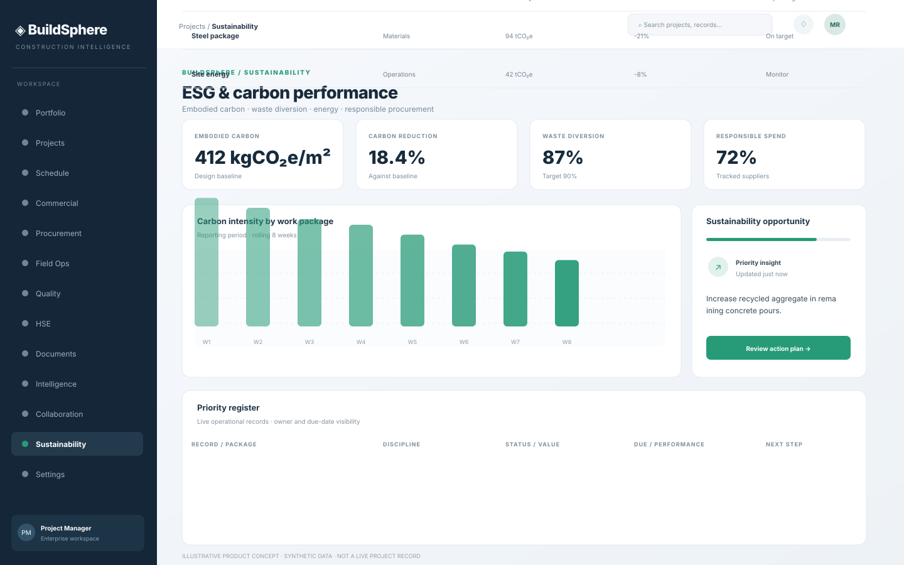

---

## 3. Technology stack

| Layer | Technology |
|---|---|
| Web application | React 19, TypeScript, Vite |
| API | Node.js 22+, Express 5, TypeScript |
| Persistence | MongoDB 7+, Mongoose 8 |
| Validation | Zod |
| Authentication | JWT access tokens, bcrypt password hashing, opaque rotating refresh sessions |
| Security | Helmet, CORS allowlist, rate limiting, request IDs, tenant-scoped queries |
| Collaboration | MongoDB outbox, leased worker, idempotent delivery, retry/backoff and fencing |
| Document security | Private filesystem adapter, SHA-256 integrity, ClamAV INSTREAM scanning |
| Quality gates | TypeScript builds, Node test runner, MongoDB replica-set integration tests, Docker image build |
| Runtime | Multi-stage Docker image; API runs as non-root `node` |

The repository is an npm workspace monorepo:

```text
apps/
  api/                 Express API, domain modules and integration tests
  web/                 React application and workflow workspaces
packages/
  shared/              Shared contracts and constants
docs/
  api/                 API and workflow documentation
  architecture/        Architecture decisions and system overview
  security/            Security and operational guidance
  screenshots/         12 illustrative SVG dashboard concepts
infrastructure/
  docker/              Local and deployment infrastructure notes
.github/workflows/     CI pipeline
Dockerfile             Production API container build
```

## 4. Implemented product capabilities

### 4.1 Identity, organizations and access control
- Account registration and login with bcrypt password hashing.
- Short-lived access JWTs and rotating opaque refresh sessions stored as hashes.
- HttpOnly, SameSite refresh cookie; logout revocation and authenticated profile.
- Organization-scoped memberships and role checks.
- Owner/admin organization membership management, including suspension/reactivation and last-active-owner protection.
- Project membership roles for project managers, contributors and viewers.
- Server-derived tenant scope; client-supplied organization IDs are not trusted.

### 4.2 Portfolio and project delivery
- Organization-scoped project creation, listing, detail and updates.
- WBS/work items, milestones, predecessor references and progress/status fields.
- Project membership and task assignment validation.
- Portfolio dashboard and project-level workspaces.

### 4.3 Commercial and procurement controls
- Cost codes and allocated project budgets.
- Purchase-order, invoice and payment-claim records.
- Workflow status transitions and commercial summary metrics.
- Procurement and commitment visibility through the commercial register.

**Boundary:** this is an operational commercial register, not a statutory accounting ledger. Financial decimal precision, immutable journals, tax, retention, partial-payment reconciliation, integrations and formal cost forecasting need additional engineering before financial reliance.

### 4.4 Field operations
- Contractor registry and contact/status records.
- Daily reports, labour by trade, equipment usage, progress, weather, delays and site observations.
- HTTPS photo-evidence references and optional location coordinates.

**Boundary:** field photo URLs are references until uploaded through a secure file workflow. Offline-first sync, payroll, equipment telemetry and auditable report amendments are not implemented.

### 4.5 Quality, safety and coordination
- Inspection registers and checklist outcomes.
- NCR/CAPA lifecycle with verification gates.
- Hazard, near-miss and incident records.
- RFI submission/response and submittal review workflows.
- Project document metadata and approval history.

### 4.6 Secure project documents
- Metadata-first document registration and controlled version history.
- Binary upload for PDF, PNG, JPEG and WEBP (maximum 25 MiB per file).
- File extension, MIME type and signature checks; sanitized display names and opaque storage keys.
- ClamAV scanning before a file is persisted as an accepted document version.
- Private file storage outside the web root; authenticated, tenant/project-scoped downloads.
- SHA-256 and byte-size metadata, verified again before download.
- Append-only application-level upload/download audit events with actor, project, document, checksum and request ID.
- Version upload, approval workflow and authenticated download UI.

**Operational prerequisite:** uploads fail closed unless MongoDB transactions and ClamAV are available. Configure a durable private storage volume. The current adapter is a single-node/private POSIX filesystem implementation, not S3/GCS/Azure object storage. Multi-replica deployments need a shared secure filesystem or a distributed object-storage adapter.

### 4.7 Explainable project intelligence
- Deterministic risk signals across schedule, budget/commitments, quality, safety and coordination.
- Evidence register with source records and concise recommendations.
- Tenant-scoped project intelligence endpoints and workspace.

**AI transparency:** the current engine is rule-based and explainable. It does not call an LLM, train a machine-learning model, calculate a critical path or provide calibrated risk probabilities. It is decision support, not a replacement for project controls judgement.

### 4.8 Collaboration and audit reliability
- Persisted recipient-scoped notifications and unread counts.
- Tenant/project-scoped activity feed.
- Project membership and assignment-aware event recipients.
- Transactional domain mutation plus outbox insertion on supported MongoDB topologies.
- Worker leases, fencing tokens, idempotent activity/notification creation, bounded retries and replay controls.
- Document file access audit events.

Application-level append-only semantics are not equivalent to cryptographic tamper evidence. Privileged direct database or storage-volume access is outside that guarantee.

## 5. Security model and operational guarantees

1. **Tenant isolation:** organization scope comes from the authenticated active membership and is applied server-side.
2. **Role enforcement:** organization and project permissions are checked at API boundaries.
3. **Session revocation:** user and membership status/role are rechecked on authenticated requests.
4. **Input validation:** Zod schemas validate workflow inputs; binary upload additionally validates content type and signatures.
5. **Document privacy:** files are not served from a public static directory; downloads require an active project membership.
6. **Malware scanning:** ClamAV scan must return clean; scanner errors/timeouts do not silently pass.
7. **Integrity:** SHA-256 and size are checked before file delivery.
8. **Event consistency:** transaction-capable MongoDB is required for atomic domain/outbox writes.
9. **Operational diagnostics:** liveness/readiness endpoints, request correlation IDs and structured API logging.
10. **Least privilege:** run the container as non-root and restrict MongoDB, scanner and storage network/volume access.

### MongoDB transaction modes

- `OUTBOX_TRANSACTION_MODE=required`: fail API startup if MongoDB is not a replica set or sharded cluster. Recommended for production.
- `auto`: detect topology; on standalone MongoDB use an explicitly reported non-atomic collaboration fallback.
- `disabled`: explicitly disable outbox transactions.

Secure document uploads require transaction mode `enabled` even if the rest of the API is configured for fallback.

### Document storage and malware scanner

- `DOCUMENT_STORAGE_DIR`: private persistent volume; Docker default is `/var/lib/buildsphere/documents`.
- `CLAMD_HOST`: private ClamAV daemon host.
- `CLAMD_PORT`: ClamAV TCP port (default `3310`).

Never expose the ClamAV daemon publicly. Keep signatures updated, encrypt and back up the document volume, monitor capacity, and test restore procedures.

## 6. Getting started

### Prerequisites
- Node.js 22 or newer
- npm 10 or newer
- MongoDB 7 or newer
- Optional for secure binary uploads: ClamAV daemon and a writable private storage directory

### Install and configure

```bash
git clone https://github.com/matiur25580/BuildSphere-Enterprise-Construction-Intelligence-Platform.git
cd BuildSphere-Enterprise-Construction-Intelligence-Platform
cp .env.example .env
# Start a local MongoDB replica set and ClamAV service
docker compose -f infrastructure/docker/compose.yaml up -d
npm install
```

Set at least:
- `MONGODB_URI`
- `JWT_ACCESS_SECRET` (unique random secret, at least 32 characters)
- `CLIENT_URL` (exact frontend origin)
- `OUTBOX_TRANSACTION_MODE`

The included Compose file starts a single-node MongoDB replica set and a private ClamAV service for local development. Wait for MongoDB to become healthy and allow ClamAV to finish its initial signature setup before uploading files. The sample `.env` uses `replicaSet=rs0` and `OUTBOX_TRANSACTION_MODE=required`; secure document uploads return `503` until both transaction support and malware scanning are available.

For document upload testing, also configure `CLAMD_HOST`, `CLAMD_PORT`, and a writable `DOCUMENT_STORAGE_DIR`. The API deliberately rejects uploads when malware scanning is not configured.

### Start the application

```bash
npm run dev
```

- Web application: http://localhost:5173
- API liveness: http://localhost:5000/api/v1/health
- API readiness: http://localhost:5000/api/v1/ready

### Build and test

```bash
npm run build
npm test --workspace=@buildsphere/api
```

The MongoDB integration suites require `MONGODB_URI` pointing to a transaction-capable replica set and a `JWT_ACCESS_SECRET` of at least 32 characters. The secure document suite starts a local fake ClamAV protocol endpoint to verify clean and malware-positive scanner outcomes; production scanner effectiveness depends on the real ClamAV service and current signatures.

## 7. API route map

All protected routes use bearer access tokens. See the linked API documents for request schemas, transitions, role gates and error semantics.

| Area | Base path | Documentation |
|---|---|---|
| Authentication | `/api/v1/auth` | [Authentication](docs/api/authentication.md) |
| Organization members | `/api/v1/organization` | [Organization membership](docs/api/organization-membership.md) |
| Projects and work items | `/api/v1/projects` | [Projects](docs/api/projects.md) |
| Commercial records | `/api/v1/projects/:projectId/commercial` | [Commercial management](docs/api/commercial-management.md) |
| Field operations | `/api/v1/projects/:projectId/field` | [Field operations](docs/api/field-operations.md) |
| Quality, safety and documents | `/api/v1/projects/:projectId/delivery` | [Delivery workflows](docs/api/quality-safety-documents.md) |
| Secure binary documents | `/api/v1/projects/:projectId/delivery/documents` | [Secure document management](docs/api/secure-document-management.md) |
| Project intelligence | `/api/v1/projects/:projectId/intelligence` | [Project intelligence](docs/api/project-intelligence.md) |
| Collaboration and activity | `/api/v1/projects/:projectId/collaboration` | [Collaboration](docs/api/collaboration.md) |
| Project membership and outbox | `/api/v1/projects/:projectId` | [Membership and outbox](docs/api/project-membership-and-outbox.md) |

## 8. CI and verification

GitHub Actions runs on pushes and pull requests to `main`. The pipeline:
1. Starts a MongoDB 7 single-node replica set.
2. Installs workspace dependencies on Node.js 22.
3. Builds API and web workspaces.
4. Runs API unit tests and MongoDB-backed integration tests.
5. Builds the production API Docker image.

Tests cover security configuration, intelligence rules, collaboration scoping, notification ownership, HTTP/JWT role and tenant boundaries, transactional outbox rollback/commit, worker lease recovery/fencing, organization governance, and secure document upload/download scanning and authorization.

CI success demonstrates that the checked-in build and automated test suite passed in that CI environment. It does not certify a production deployment, a real ClamAV signature database, cloud storage durability, compliance, penetration testing or live operational readiness.

## 9. Roadmap — next enterprise increments

1. **Distributed document storage:** S3-compatible adapter, signed access, resumable multipart uploads, retention and orphan reconciliation.
2. **BIM and drawing workflows:** IFC/DWG/BCF integration, drawing comparison, model issue coordination and markup.
3. **Enterprise identity:** MFA, SSO/OIDC/SAML, SCIM provisioning, delegated administration and organization switching.
4. **Project controls depth:** Gantt, critical path, schedule baselines, earned value, change control and resource loading.
5. **Commercial maturity:** decimal-safe money, tax/retention, payment reconciliation, change orders and accounting integrations.
6. **Field-first delivery:** offline sync, mobile capture, geotagged evidence and permit-to-work workflows.
7. **Operational intelligence:** calibrated forecasting, scenario modelling and human-reviewed AI-assisted reporting.
8. **Sustainability:** verified material EPD data, embodied-carbon calculations, waste and energy reporting.
9. **Observability and governance:** metrics/tracing export, alerting, immutable external audit archive, retention/legal hold and disaster-recovery exercises.
10. **Interoperability:** open APIs, webhooks, ERP/BIM integrations and data export.

## 10. Engineering principles

- Enforce tenant isolation and authorization on the server, not only in the UI.
- Make workflow state transitions explicit and validate every boundary.
- Preserve evidence provenance; distinguish recorded facts from inferred risk signals.
- Fail closed when malware scanning or required transaction guarantees are unavailable.
- Prefer durable, observable workflows over placeholder feature breadth.
- Document operational prerequisites and limitations honestly.
- Keep synthetic screenshots and demo data clearly labelled as illustrative.

## 11. Contributing

1. Create a focused branch for substantial changes.
2. Follow the existing TypeScript, Mongoose, Express and React conventions.
3. Add tenant-boundary and role tests for new API routes.
4. Add MongoDB integration tests for transaction-sensitive workflows.
5. Update the relevant API docs and this README when behaviour or operational requirements change.
6. Run builds and tests before opening a pull request.

## 12. License and product maturity

No open-source license is currently declared in this repository. Do not assume permission for redistribution or commercial reuse until a license is added.

BuildSphere is an evolving engineering project intended to demonstrate a serious construction-domain SaaS architecture. Evaluate it by its implemented code, tests and documented boundaries—not by the illustrative dashboard concepts alone.
